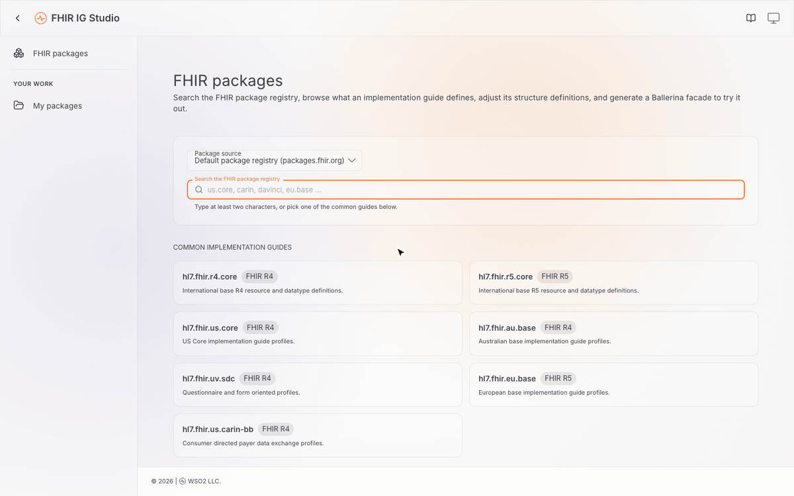

# FHIR IG Studio

A web tool for working with FHIR implementation guides, built on the codegen libraries in this repository:

1. **Load an implementation guide** from the FHIR package registry (`packages.fhir.org`), a registry of your
   own, or a `.zip`/`.tgz` of definitions you upload.
2. **Profile it** — constrain elements in place from the same Differential and Snapshot tables published IG
   sites show, author new profiles and extensions, or describe a change to the **FHIR Dev Bot** and apply what
   it proposes. Every change is checked against the FHIR profiling rules before it is written.
3. **Generate an executable FHIR facade** — a Ballerina service with an API per resource, its search
   parameters, and a capability statement at `/metadata`, compiled and handed over as a download.



*US Core 6.1.0 opened from the registry, `AllergyIntolerance.onset[x]` made mandatory in place, a change asked of
the Dev Bot and applied, and a facade generated, ready to download. Waits are sped up.*

```
tools/fhir-ig-studio/
├── service/     Java HTTP service (the BFF): registry access, the definition workspace, generation, the Dev Bot
├── ui/          React + Vite front end, using the WSO2 Oxygen UI design system
├── packaging/   run scripts and README that ship inside the release zip
├── docs/        the recording above
└── package.sh   builds both and assembles the release zip
```

## Run the binary distribution

Download `fhir-ig-studio-<version>.zip` from the
[releases tagged `fhir-ig-studio-v*`](https://github.com/ballerina-platform/fhir-tools/releases), then:

```shell
unzip fhir-ig-studio-<version>.zip
cd fhir-ig-studio-<version>
./run.sh          # macOS and Linux; run.bat on Windows
```

and open <http://localhost:9095/>.

- **Java 21 or later** is the prerequisite. It runs the Studio, and the generated FHIR facades run on it too.
- **A chat model** is optional, for the Dev Bot. See [The Dev Bot](#the-dev-bot).

The `README.md` inside the zip covers the same ground for someone who only has the zip.

## Build from source

### Prerequisites

| | Version | For |
| --- | --- | --- |
| Java | 21+ | the service |
| Maven | 3.9+ | building the service |
| Node.js | 20.19+ or 22.12+ | building the UI |
| Ballerina | Swan Lake 2201.12.3 (optional) | compiling generated facades |

The service depends on the **released** fhir-tools codegen jars (`version.health.tools` in
[`service/pom.xml`](service/pom.xml)), and those, the
[`wso2/open-healthcare-codegen-tool-framework`](https://github.com/wso2/open-healthcare-codegen-tool-framework)
jars under them, and `org.ballerinalang:ballerina-cli` are all served from **GitHub Packages**. GitHub Packages
needs a token even for public packages, but any GitHub account's will do: create a
[personal access token (classic)](https://github.com/settings/tokens) with only the `read:packages` scope, and
add it to `~/.m2/settings.xml` under each repository id the pom declares:

```xml
<settings>
  <servers>
    <server>
      <id>fhir-tools-repo</id>
      <username>{github-username}</username>
      <password>{github-pat}</password>
    </server>
    <server>
      <id>codegen-framework-repo</id>
      <username>{github-username}</username>
      <password>{github-pat}</password>
    </server>
    <server>
      <id>ballerina-language-repo</id>
      <username>{github-username}</username>
      <password>{github-pat}</password>
    </server>
  </servers>
</settings>
```

A fine-grained token does not work with GitHub's Maven registry; it has to be a classic one.

### Build and run

```shell
cd tools/fhir-ig-studio

# 1. the UI (emits ui/dist, which the service finds and serves on its own)
cd ui && npm ci && npm run build && cd ..

# 2. the service
cd service && mvn clean package
java -jar target/health-service.jar
```

Then open <http://localhost:9095/>.

### Developing the UI

With the service running as above, in another shell:

```shell
cd tools/fhir-ig-studio/ui
npm run dev       # http://localhost:5173, with hot reload; /api is proxied to the service on 9095
```

### Against unreleased fhir-tools changes

The service takes the codegen jars from your local Maven repository before GitHub Packages. To try it against
changes in this repository that are not released yet, install them at the version the service pins, from the
repository root:

```shell
mvn clean install        # installs io.ballerina:health-cli and friends at the version in the root pom.xml
```

and set `version.health.tools` in `service/pom.xml` to that version if it differs.

## Configuration

Settings are read from a `-D` system property, then an environment variable, then
`~/.fhir-tool-service/service.properties`, then a default. The common ones:

| System property | Environment variable | Default | |
| --- | --- | --- | --- |
| `fhir.tool.service.port` | `FHIR_TOOL_SERVICE_PORT` | `9095` | Listen port |
| `fhir.tool.service.host` | `FHIR_TOOL_SERVICE_HOST` | `0.0.0.0` | Bind address |
| `fhir.tool.service.workspace` | `FHIR_TOOL_SERVICE_WORKSPACE` | `~/.fhir-tool-service` | Opened packages, uploads and generated facades |
| | `BAL_COMMAND` | `bal` | The Ballerina command used to compile facades |

The full list, the workspace layout and the REST API are in [`service/README.md`](service/README.md).

### The Dev Bot

The Dev Bot is off until it is pointed at a chat model. Any OpenAI-compatible API works (Ollama, LM Studio,
vLLM, OpenAI, …), as do Anthropic and Azure OpenAI. For a model on your own machine:

```shell
brew install ollama && brew services start ollama     # or see https://ollama.com/
ollama pull qwen2.5-coder:7b
```

and in `~/.fhir-tool-service/service.properties`:

```properties
fhir.tool.service.modelUrl=http://localhost:11434/v1
fhir.tool.service.model=qwen2.5-coder:7b
```

A hosted provider also needs `FHIR_TOOL_SERVICE_MODEL_API_KEY`. The open profile is sent to whichever model is
configured, so prefer a local one for an unpublished guide. More in
[`service/README.md`](service/README.md#the-chat-model--optional-off-by-default).
